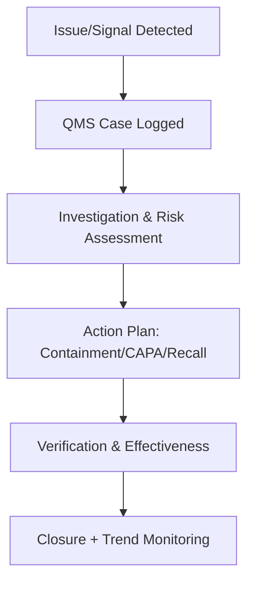

# QMS Module Understanding Guide (Task 2 Support)

This document is a ready study script for your Task 2 video.

## 1) In-Process Quality

### A. Deviation Management
**Purpose:** Track and close events where process steps deviate from approved SOP.

**End-to-End Flow:**
1. Deviation identified on shop floor/QC lab.
2. QA logs deviation with severity and batch impact.
3. Immediate containment actions executed.
4. Root cause analysis (5-Why/Fishbone).
5. QA/Production approve corrective action plan.
6. Effectiveness check completed and closure done.

**API example:** API drying temperature exceeded by +4°C for 20 minutes.
**Raw Material example:** Incoming excipient moisture outside spec.

### B. CAPA (Corrective and Preventive Actions)
**Purpose:** Prevent recurrence of deviations and systemic quality issues.

**End-to-End Flow:**
1. CAPA raised from deviation/audit/trend.
2. Action owner assigned with due dates.
3. Corrective + preventive actions implemented.
4. QA verifies evidence.
5. Effectiveness review after defined interval.
6. CAPA closed or reopened.

## 2) In-Product Quality

### A. Product Complaints
**Purpose:** Capture market complaints and assess quality impact.

Flow:
1. Complaint intake (email/call/distributor portal).
2. Case triage: quality vs non-quality complaint.
3. Sample retention and lab investigation.
4. Root-cause and batch genealogy review.
5. Response to complainant + regulatory action if needed.
6. Closure and trend analysis.

### B. Recall Management
**Purpose:** Rapidly remove potentially harmful products from market.

Flow:
1. Trigger event (serious complaint/OOS/stability failure).
2. Health hazard assessment.
3. Recall class assignment.
4. Distributor/customer notifications.
5. Reconciliation of returned stock.
6. Final recall effectiveness report.

### C. Adverse Event Reporting
**Purpose:** Pharmacovigilance linkage for patient safety signals.

Flow:
1. AE intake from HCP/patient/call center.
2. Medical assessment and seriousness grading.
3. Regulatory submission timelines applied.
4. Cross-functional review (PV + QA + Medical).
5. Signal tracking and risk mitigation updates.

## 3) QMS Management

### Supplier Management
**Purpose:** Approve, monitor, and requalify suppliers for APIs and raw materials.

Flow:
1. Supplier onboarding + qualification questionnaire.
2. Risk scoring + audit planning.
3. Technical agreement and approved supplier list.
4. Ongoing scorecard (OTIF, OOS, deviations).
5. Periodic requalification.

## 4) Role-based SME Perspective

### Quality Executive / QA Officer
- Ensures deviations and CAPA are scientifically documented.
- Owns quality decision, closure, and compliance evidence.
- Watches trend metrics and escalates recurring risk.

### Production Manager
- Executes containment and process corrections quickly.
- Ensures manufacturability and throughput with quality compliance.
- Coordinates operators, engineering, and QA during investigations.

## 5) Simple Flowchart (can redraw in your own style)

Use this as a speaking backbone, then personalize with your own observations from the platform walkthrough.
